# 🌿 Krishi AI – Intelligent Farming Decision System
> **Commercial-Grade AgriTech SaaS Platform: Predictive AI, Mandi Logistics, Multi-Market Arbitrage & Fraud Defense**

[](https://www.python.org/)
[](https://streamlit.io/)
[](https://duckdb.org/)
[](https://scikit-learn.org/)
[](https://openrouteservice.org/)
[](https://github.com)

---

## 📌 Executive Summary

Smallholder and commercial farmers across India face systemic challenges: suboptimal crop choices, lack of mandi price visibility, expensive road transport, and predatory buyer quotes.

**Krishi AI** solves this with an end-to-end intelligence suite:
1. **Precision Agronomy**: Machine learning crop suitability classifier (97%+ accuracy) + Soil Health Index (0–100) + Urea/DAP/MOP 50kg bag fertilizer prescriptions.
2. **Logistics & Net Proceeds Engine**: Real road routing (OpenRouteService) evaluating 2,733 wholesale mandis. Deducts freight, APMC cess (1.5%), commission agent fees (2.0%), and handling to rank markets by **True In-Hand Net Profit** (revealing up to ₹9,600+ net arbitrage over local mandis).
3. **DuckDB 4-Year Price Forecasting**: Sub-second lazy scans over multi-year agricultural parquet archives with lag-feature time-series regression for 3/7/14-day price forecasting.
4. **Deterministic Sell Advisor**: Financial model factoring in storage costs and spoilage degradation to recommend **Sell Now**, **Wait**, or **Split Delivery**.
5. **Anti-Fraud Parity**: Predatory buyer quote anomaly detection, farmer loss quantification, and auto-generated counter-negotiation scripts citing official APMC rates.
6. **Enterprise Authentication**: Argon2id/bcrypt password hashing, rate-limited login throttling, and private tenant data isolation.

---

## 🏗️ System Architecture

```mermaid
flowchart TD
    subgraph Client ["Client Interface (Streamlit SaaS)"]
        UI["High-Contrast AgriTech UI<br/>(Emerald & Dark Slate Palette)"]
    end

    subgraph Auth ["Security & Tenancy"]
        AUTH_DB["SQLite User & Farm DB<br/>(bcrypt Cost 12 • Rate Limiting)"]
    end

    subgraph Agronomy ["Agronomic Intelligence"]
        CROP_ML["Crop Recommendation RF Classifier<br/>(NPK, Temp, Humidity, pH, Rainfall)"]
        SOIL_ENG["Soil Health Index & NPK Deficit"]
        YIELD_ML["Harvest Volume Regressor"]
    end

    subgraph Logistics ["Market Logistics & Arbitrage"]
        ORS["OpenRouteService Matrix Engine<br/>(Distance, Duration, Circuity Factor)"]
        TRANS["Cold-Chain vs Normal Freight Model"]
        MANDI_PROC["Net Proceeds Calculator<br/>(Gross Price - Cess - Freight - Labor)"]
    end

    subgraph Forecasting ["Predictive Time Series"]
        DUCK["DuckDB Parquet Lazy Scanner<br/>(2023-2026 Historical Timeseries)"]
        FORECAST_ML["Lag Feature Regressor (t-1, t-7, t-14, t-30)"]
        SELL_OPT["Financial Sell Now vs Wait Engine"]
    end

    subgraph Defense ["Fair Price Defense"]
        FRAUD["Predatory Bid Anomaly Detector"]
        COUNTER["Counter-Offer Script Generator"]
    end

    UI --> AUTH_DB
    UI --> CROP_ML & SOIL_ENG & YIELD_ML
    UI --> ORS & TRANS & MANDI_PROC
    UI --> DUCK & FORECAST_ML & SELL_OPT
    UI --> FRAUD & COUNTER
```



---

## 🚀 Quick Start Guide

### 1. Prerequisites
- Python 3.10 – 3.14 (64-bit)
- Git

### 2. Clone Repository & Setup
```bash
# Clone the repository
git clone https://github.com/supreethhegde4-dev/krishi-ai.git
cd krishi-ai

# Install dependencies
python -m pip install -r requirements.txt
```

### 3. Launch Application
```bash
python -m streamlit run app.py
```
Open **`http://localhost:8501`** in your browser.

---

## 🔑 Demo Access Credentials

The platform includes pre-seeded demonstration accounts for instant 1-click evaluation:

| Role | Email | Password | Access Level |
| :--- | :--- | :--- | :--- |
| **🧑‍🌾 Demo Farmer** | `farmer@krishiai.com` | `Password@123` | 5-Acre Tomato Enterprise (Ramanagara, Karnataka) |
| **🛡️ Demo Administrator** | `admin@krishiai.com` | `Admin@123` | System Analytics, APMC Mandi Oversight |

---

## 📊 Modules & Verification

Run the comprehensive automated test suites:

```bash
# 1. Run Authentication & SaaS Redesign Verification
python tests/test_auth_and_redesign.py

# 2. Run End-to-End Agronomic & Logistics Verification
python tests/test_end_to_end.py
```

Both test suites run 21 end-to-end verification tests with a **100% pass rate**.

---

## 📄 License
MIT License. Built for the Intelligent Analytics and Predictive AI AgriTech Buildathon.
